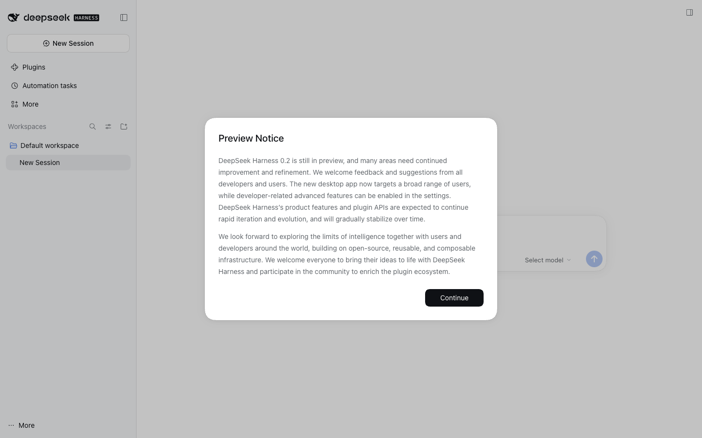
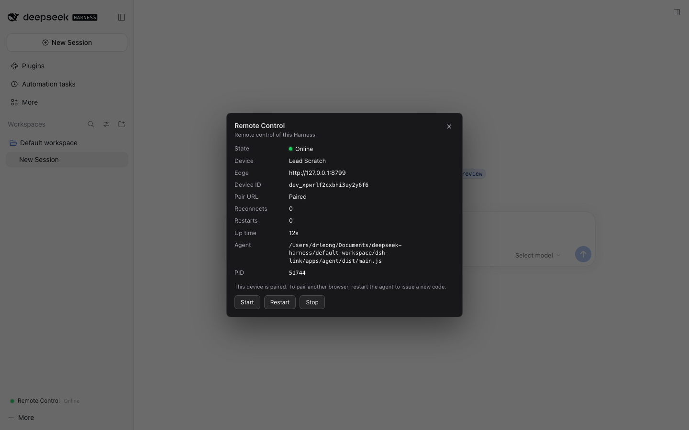
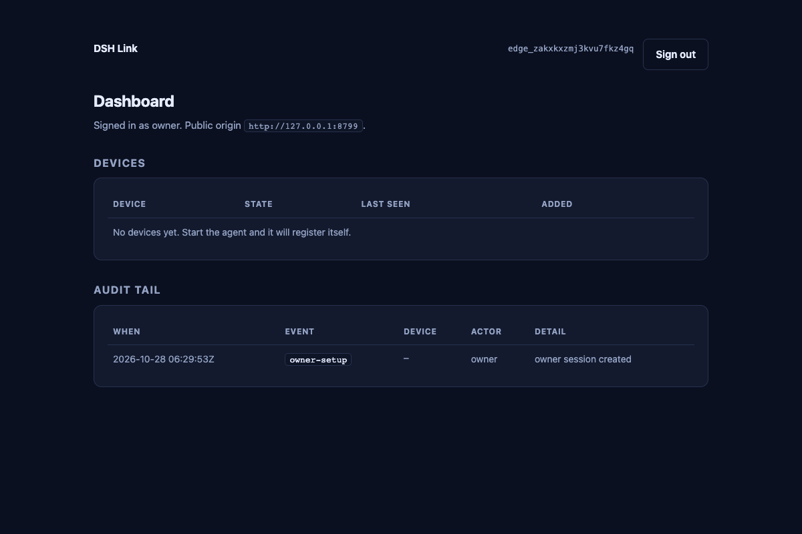

# DSH Link

**Remote access to your DeepSeek Harness desktop, through one TLS WebSocket and
the browser you already have.**

**Created by Ts. Dr. Leong Yee Rock** · VYROX International Sdn Bhd (VYROX AI)

DSH Link serves the *unmodified* Harness web UI over a single outbound
connection. The desktop agent dials the edge; the edge proxies HTTP and
WebSocket streams to it; your browser opens the real DSH interface. No WebRTC,
no UDP, no inbound port, no port forwarding, and no second client to install on
the machine in front of you.



That screenshot is not a mockup: it is the real Harness 0.2.1 session, loaded
from `http://<edge>/d/<device>/` in headless Chromium by
[`tools/e2e/real-dsh.mjs`](tools/e2e/real-dsh.mjs), with owner setup, device
registration and pairing all driven over HTTP first. Reproduction command is in
[Verification](#verification).

> **Status: v0.1.0.** Protocol, mux, edge, agent, plugin, tests and docs are
> implemented. 197 automated tests are green, the real-DSH end-to-end proof
> passes, and the benchmark numbers below are measured. It is pre-release
> software: treat the plugin as beta and read
> [THREAT-MODEL.md](docs/THREAT-MODEL.md) before exposing a desktop.

## The problem with the previous remote plugin

The reference plugin (`liguobao/ds-harness-remote`) is a serious project, and it
does things this v1 does not: Android and VS Code clients, and application-layer
end-to-end encryption against its relay. Its weakness is **topology and surface
area**, and that is what users outside China experience as "it hangs, then it
disconnects".

| # | What the previous plugin does | Why it hurts outside China |
| --- | --- | --- |
| 1 | WebRTC is attempted first; ICE is abandoned only after 8 s (`DEFAULT_NEGOTIATE_TIMEOUT_MS`), with a 15 s control handshake | Every connection on a UDP-filtered network starts with a multi-second stall before fallback even begins |
| 2 | STUN/TURN requires UDP; TURN adds another relay hop and bandwidth cost | Hotel, corporate, campus and CGNAT networks drop UDP; the fallback is slower and still fails |
| 3 | The documented/default server is `dsh.r2049.cn`, hosted in mainland China | Users outside China relay every session across a long, lossy path; RTT alone makes typing feel stuck |
| 4 | Android app + VS Code client + `client-core` re-implement Harness RPC | Two protocol surfaces to keep in sync; a stalled projection looks like a frozen app, and desktop features lag |
| 5 | Reconnect tears the connection down and re-runs membership, fixed-key trust, transport selection and Noise | A Wi-Fi blip costs seconds and loses in-flight UI state |
| 6 | Node WebRTC is an optional native addon (`@roamhq/wrtc`) | Install/ABI fragility that only appears on some machines, then silently degrades to relay |

None of these is a bug in isolation. Together they explain the complaint: the
system spends its first seconds trying a transport that usually cannot work,
through a relay that is far away, and after a blip it starts over.

## How Remote Control solves it

Remote Control makes the opposite bet: **one reliable transport, the real UI,
and an edge you place near yourself.**

| Previous problem | What Remote Control does instead | Where |
| --- | --- | --- |
| 8 s ICE attempt, 15 s handshake | One outbound WSS on 443; no ICE/STUN/TURN to negotiate or time out | `packages/mux`, `apps/agent` |
| UDP-dependent paths | TCP/TLS only; works through corporate proxies, TLS inspection, CGNAT and IPv6-only networks | [`docs/ARCHITECTURE.md`](docs/ARCHITECTURE.md) |
| China-hosted relay by default | Self-hosted edge; for China ↔ abroad put it in Hong Kong, Singapore, Tokyo or Seoul — it is the only hop | [`docs/DEPLOY.md` §0](docs/DEPLOY.md#0-choosing-a-region-read-this-first) |
| Second client drifts | The browser loads the unmodified DSH web app under `/d/<device>/`; feature parity is automatic | [`docs/ARCHITECTURE.md`](docs/ARCHITECTURE.md) §2 |
| Slow, state-losing reconnect | 15 s heartbeat, 45 s idle, full-jitter 250 ms–20 s, 30 s presence grace, measured 49 ms forced replacement, no mutation replay | `packages/mux`, `apps/agent` |
| Bulk transfer starves the UI | 256 KiB/stream and 8 MiB/tunnel credit returned on consumption; high/normal/low scheduler; p95 3.1 ms under 4 × 16 MiB | `packages/mux` |
| Native `wrtc` fragility | No native addon; Node built-ins plus `ws` | `package.json` |
| A crash leaves two agents | Per-state-dir `agent.lock` refuses a second instance; 4004 replacement is retryable, not a fight | [`apps/agent/src/lock.ts`](apps/agent/src/lock.ts) |

Security and operations change shape too: the DSH launch token never leaves the
desktop (0600 hand-off, memory-only cookie), the browser never receives a DSH
credential, device secrets are SHA-256 at rest, pair codes are single-use and
require the owner, and the edge can be self-hosted. The trade-off is explicit:
the edge terminates TLS and therefore sees plaintext proxied traffic. It is a
**trusted relay**; [THREAT-MODEL.md](docs/THREAT-MODEL.md) states what that trust
buys and costs. If you need end-to-end encryption against the relay, this v1 is
the wrong design — [ADR-0001](docs/adr/0001-no-webrtc.md) explains why we chose
it anyway.

## Architecture

```
┌─────────────┐   HTTPS + WSS (443)   ┌──────────────┐   one multiplexed WSS   ┌───────────┐   loopback HTTP/WS   ┌─────────────┐
│   browser   │ ────────────────────▶ │     edge     │ ◀────────────────────── │   agent   │ ───────────────────▶ │ DSH desktop │
│ (anywhere)  │ ◀──────────────────── │  (self-host) │ ──────────────────────▶ │ (desktop) │ ◀─────────────────── │ web server  │
└─────────────┘                       └──────────────┘                         └───────────┘                      └─────────────┘
                                       auth · pairing                          mints the DSH                     unchanged
                                       presence · audit                        cookie, proxies
```

- **Browser → edge:** ordinary HTTPS/WSS on 443. Sub-path mount
  `/d/<deviceId>/`; the app's own relative URLs and `<base href="./">` do the
  rest.
- **Edge → agent:** one WebSocket per device, multiplexed into independent HTTP
  and WebSocket streams, with per-stream flow control and a weighted scheduler
  (high/normal/low) so bulk traffic cannot starve the UI.
- **Agent → DSH:** `127.0.0.1:<port>` only, with a cookie obtained from the DSH
  launch token. The token and cookie never leave the desktop.

Details: [ARCHITECTURE.md](docs/ARCHITECTURE.md) ·
[PROTOCOL.md](docs/PROTOCOL.md) ·
[ADR-0001: no WebRTC](docs/adr/0001-no-webrtc.md).

## Requirements

| Component | Requirement |
| --- | --- |
| Desktop | DeepSeek Harness **0.2.1-rc.3** (plugin declares `>=0.2.1-rc.3 <0.3.0`) |
| Edge | Node.js ≥ 22.13 (or the Docker image), a domain for TLS in production |
| Browser | Any current Chromium, Firefox or Safari |
| Network | Outbound 443 from the desktop; no inbound ports, no UDP |

## Quick start

### 1. Edge

On a small VPS (or your laptop for a demo):

```bash
git clone https://github.com/yeerock/dsh-rc && cd dsh-rc
npm ci && npm run build

node apps/edge/dist/main.js \
  --host 0.0.0.0 --port 8787 \
  --data-dir ~/.dsh-link --public-url https://link.example.com
```

It prints a one-time **setup code** (rotated each boot until setup completes).
Put TLS in front with the included [Caddy + Docker setup](docker/docker-compose.yml),
or terminate TLS at your load balancer and run with `--trust-proxy`.

### 2. Agent (or let the plugin do it)

```bash
node apps/agent/dist/main.js \
  --edge https://link.example.com \
  --dsh-url-file ~/.dsh-link/agent/upstream.json \
  --state-dir ~/.dsh-link/agent \
  --name my-desktop \
  --status-file ~/.dsh-link/agent/status.json
```

`upstream.json` is `{ "url": "http://127.0.0.1:<port>/?token=…" }`, mode 0600.
The token is deliberately **not** accepted on argv. On first run the agent
prints `DSH_LINK_PAIR_URL=…`; open it while signed in as the owner to approve
the device and pair the browser. The DSH UI is then at
`https://link.example.com/d/<deviceId>/`.

### 3. Desktop plugin (recommended)

The plugin appears in Harness as **Remote Control**. It mints the authenticated
URL from the running DSH desktop, writes it to a 0600 file, spawns and
supervises the agent, and shows a status panel in the Harness sidebar: state, device id, latency, reconnects, start/restart/stop
controls, and — while pairing only — the pair link with a QR code. Once online
the panel shows "Paired" instead of a dead QR.



```bash
dsh plugin --profile <profile> add link:"$PWD/packages/plugin"
```

Enable the `dsh-link` entry in your profile's user layer,
`$DSH_HOME/profiles/<profile>/cordis.patch.yml`:

```yaml
- id: dsh-link
  config:
    enabled: true
    edgeUrl: https://link.example.com
    deviceName: my-desktop
    autoStart: true
```

Then boot that profile with `dsh --profile <profile> --port 0 --no-open`
(`--profile <name>` replaces the `dsh web` shorthand; do not append `web`).

Full install, configuration and troubleshooting:
[packages/plugin/README.md](packages/plugin/README.md). Deployment shapes,
flags and systemd: [DEPLOY.md](docs/DEPLOY.md).

## Security in one paragraph

TLS to the edge; **device secrets are 32 random bytes stored only as SHA-256**;
**pair codes are 8 characters, single-use, 10-minute TTL**, and cannot be
redeemed without an owner session or the owner password. The **DSH launch token
never leaves the desktop**: the agent exchanges it once for a loopback-bound
cookie held in memory. The browser never receives a Harness credential, and the
agent refuses non-loopback upstreams, absolute URLs, `..` segments and encoded
traversal even if the edge is compromised. The edge sees proxied plaintext;
self-host it if that matters. Residual risk and the full STRIDE pass:
[THREAT-MODEL.md](docs/THREAT-MODEL.md). Report issues per
[SECURITY.md](docs/SECURITY.md).



## Verification

```bash
npm run typecheck        # tsc -b across all workspaces
npm test                 # 168 tests: unit + integration
npm run bench:quick      # tools/bench, JSON + markdown to tools/bench/results
npm run e2e              # boots a real DSH web profile, edge and agent, then Chromium
```

`npm run e2e` is the proof behind the screenshot: isolated `DSH_HOME`, real
`dsh --profile web`, real edge, real agent, owner setup, pairing, index fetch,
`/api/remote.mux` upgrade and a Chromium render. It asserts the proxied HTML is
the Harness shell, contains no loopback origin, and that the UI renders.

Measured on an Apple M4 Pro (24 GiB, macOS 26, Node 24.18.0, 2026-10-28),
**loopback edge — these measure tunnel overhead, not internet RTT**:

| Metric | Value |
| --- | ---: |
| TTFB through edge, median / p95 | 2.1 ms / 2.9 ms |
| Throughput, 1 MiB / 16 MiB | 157 / 299 MiB/s |
| 200 sequential requests | 505 req/s (p95 2.1 ms) |
| 50 concurrent requests | 16.6 ms total (p95 ~19 ms) |
| Interactive p95 during 4 × 16 MiB bulk | 3.1 ms |
| Tunnel connect after agent restart | 2.7 ms |
| Reconnect after forced 4004 replacement | 49 ms |

Real-DSH smoke: index 37,907 B byte-identical, main JS bundle 941,436 B
SHA-256-equal through the tunnel, `remote.mux` OPEN.

## What it deliberately does not do

- **No mobile apps.** The browser is the client.
- **No WebRTC data path in v1.** See [ADR-0001](docs/adr/0001-no-webrtc.md) for
  the trade-off and the conditions under which that changes.
- **No replay of Harness mutations** after an unknown outcome.
- **No second chat/files/terminal UI.** That is the point.
- **No multi-tenant SaaS.** Self-host first; hosted accounts and OAuth are
  roadmap, not v1.

## Repository layout

| Path | What |
| --- | --- |
| [`packages/protocol`](packages/protocol) | Wire format, frame guards, path/header policy |
| [`packages/mux`](packages/mux) | Streams, flow control, priority scheduler, heartbeat |
| [`packages/shared`](packages/shared) | WebSocket adapter, tokens, cookies, logging |
| [`apps/edge`](apps/edge) | Public HTTPS/WSS relay, auth, pairing, SQLite, dashboard |
| [`apps/agent`](apps/agent) | Desktop tunnel client and loopback proxy |
| [`packages/plugin`](packages/plugin) | DeepSeek Harness plugin (host + sidebar UI) |
| [`tests`](tests), [`tools/bench`](tools/bench) | Integration, fault injection, benchmarks |
| [`docs`](docs) | Architecture, protocol, ADRs, threat model, deployment, runbook |

## FAQ

**Does my DSH token leave the machine?** No. It is never logged and never placed
in argv: the plugin hands it to the agent in a 0600 file, the agent exchanges it
once for a loopback-bound cookie held in memory, and the browser never sees
either.

**Why not P2P?** Because the reported failure is networks where P2P cannot
work, and because a browser cannot speak WebRTC to an HTTP origin without a
second client. The full argument: [ADR-0001](docs/adr/0001-no-webrtc.md).

**What happens on a flaky network?** Heartbeats every 15 s, a 45 s idle
deadline, full-jitter reconnect from 250 ms to 20 s, 30 s presence grace, and
no message replay. A desktop crash cannot leave two agents fighting: a
per-state-dir lock refuses the second one.

**Can I self-host the edge?** That is the intended deployment. One Docker
Compose file, Caddy for TLS, a SQLite file to back up.

**Where should the edge live?** Near enough to both ends that interactive RTT
stays low. If your desktop is in mainland China and you work from Europe or
North America, put the edge in Hong Kong, Singapore, Tokyo or Seoul — *not* in
mainland China, which is the failure mode this project removes. Measure both
legs; details in [DEPLOY.md §0](docs/DEPLOY.md#0-choosing-a-region-read-this-first).

More: [FAQ.md](docs/FAQ.md) · [OPERATIONS.md](docs/OPERATIONS.md).

## Creator

**Ts. Dr. Leong Yee Rock** is the creator and maintainer of DSH Link / Remote
Control.

He is from **VYROX International Sdn Bhd (VYROX AI)**, Malaysia.

- GitHub: [@yeerock](https://github.com/yeerock)
- Project: [github.com/yeerock/dsh-rc](https://github.com/yeerock/dsh-rc)

## License

MIT. See [LICENSE](LICENSE).