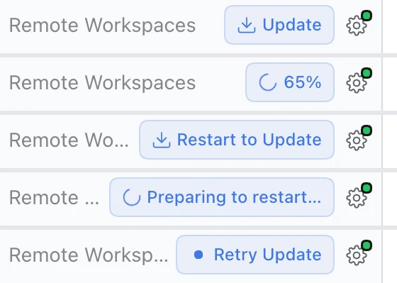
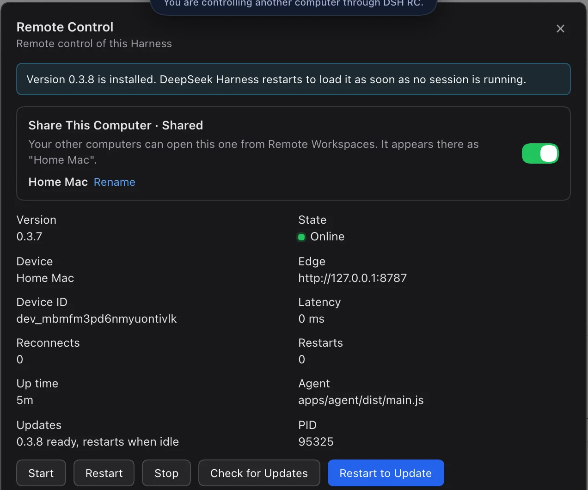
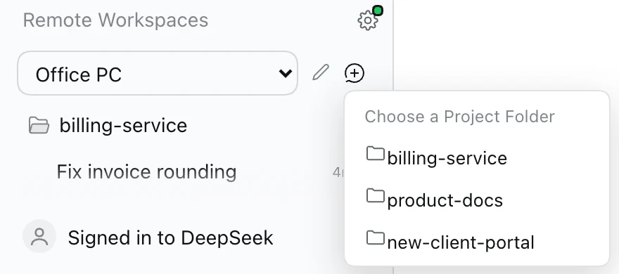
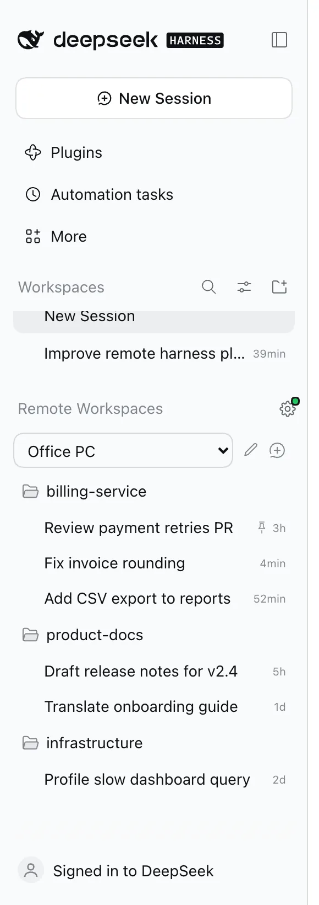
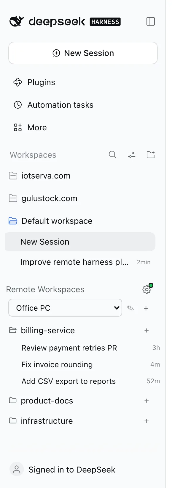
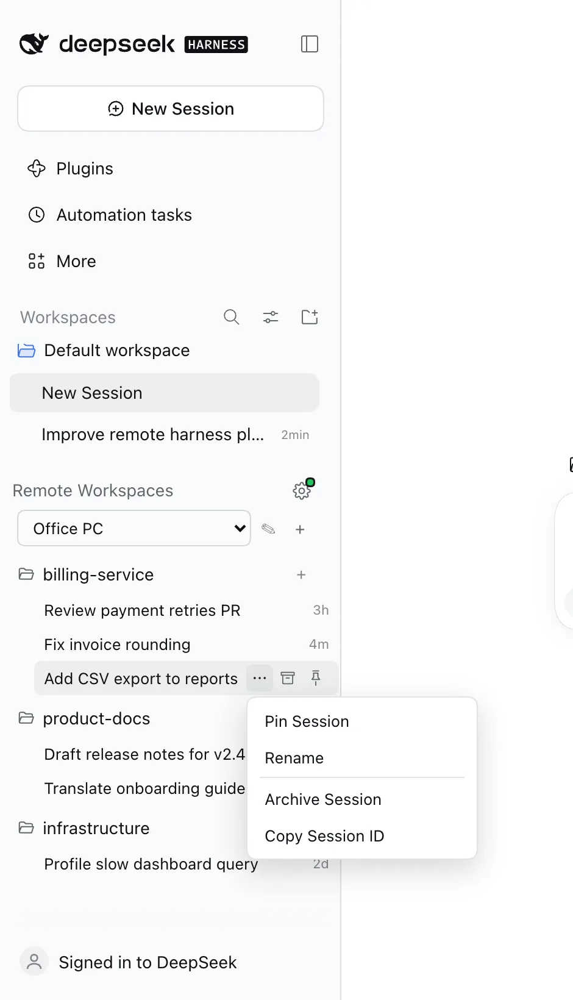
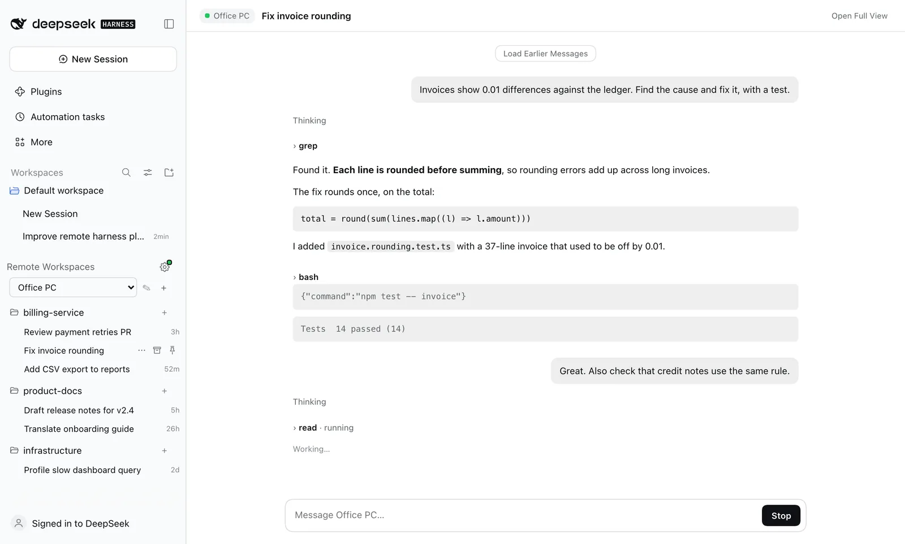
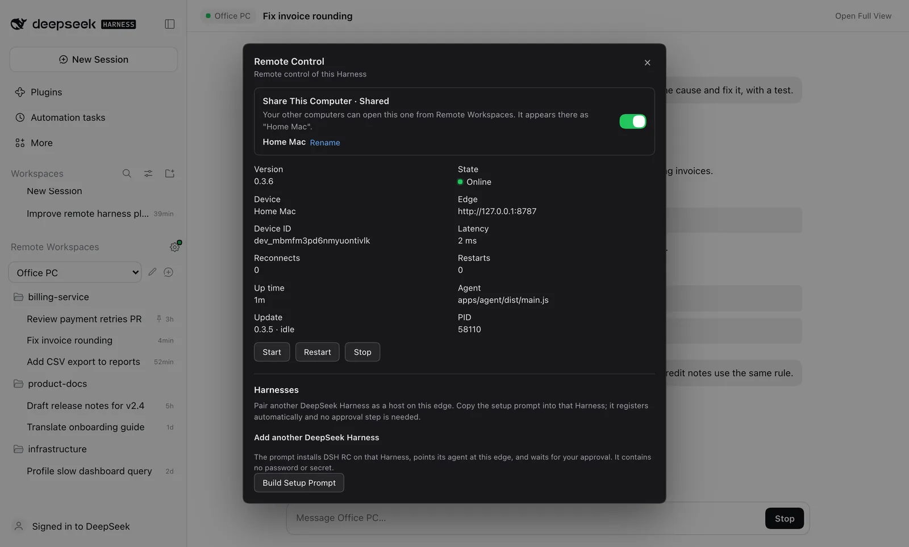
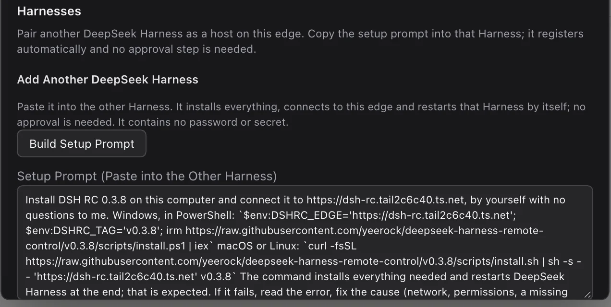
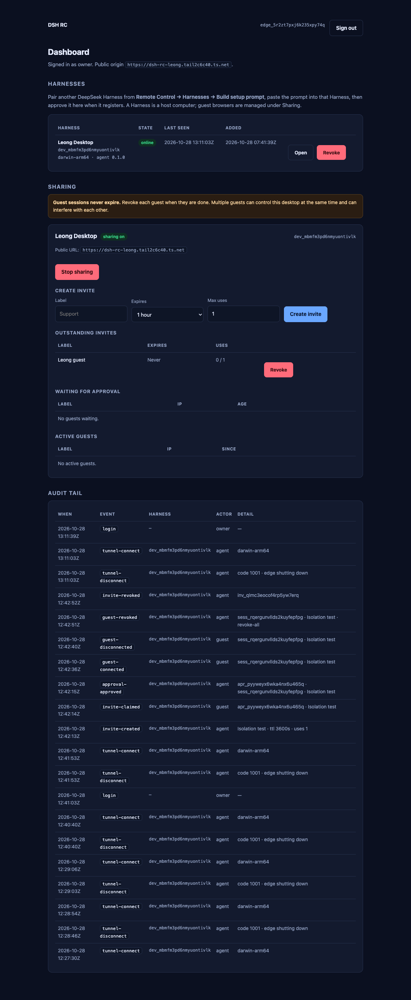

# DeepSeek Harness Remote Control (DSH RC)

**Remote access to your DeepSeek Harness desktop, through one TLS WebSocket and
the browser you already have.**

**A project by Ts. Dr. Leong Yee Rock · VYROX International Sdn Bhd · VYROX AI**

DSH RC serves the *unmodified* Harness web UI over a single outbound
connection. The desktop agent dials the edge; the edge proxies HTTP and
WebSocket streams to it; your browser opens the real DSH interface. No WebRTC,
no UDP, no inbound port, no port forwarding, and no second client to install on
the machine in front of you.


That screenshot is not a mockup: it is the real Harness 0.2.1 session, loaded
from `http://<edge>/d/<device>/` in headless Chromium by
[`tools/e2e/real-dsh.mjs`](tools/e2e/real-dsh.mjs), with owner setup, device
registration and pairing all driven over HTTP first. Reproduction command is in
[Verification](#verification).

> **Status: v0.4.15.** Protocol, mux, edge, agent, plugin, tests and docs are
> implemented. 352 automated tests are green, the real-DSH end-to-end proof
> passes, and the benchmark numbers below are measured. It is pre-release
> software: treat the plugin as beta and read
> [THREAT-MODEL.md](docs/THREAT-MODEL.md) before exposing a desktop.

## Get started in two prompts

Works on **macOS, Windows and Linux**, for both steps. Install DeepSeek Harness
and open it once on each computer. Then paste one prompt into DeepSeek Harness
and its agent does everything else: download, install, set up, connect and
restart. Or run the one command for your system yourself.

### Step 1. Your first computer (the host)

The host runs your private edge, the address every other computer connects to.
Any computer that stays on works: a Mac, a Windows PC or a Linux machine.

**Paste into DeepSeek Harness** (any system):

```text
Set up this computer as my DSH RC host, by yourself. Run the command for this system:
Windows (PowerShell): $env:DSHRC_MODE='host'; irm https://raw.githubusercontent.com/yeerock/deepseek-harness-remote-control/main/scripts/install.ps1 | iex
macOS or Linux: curl -fsSL https://raw.githubusercontent.com/yeerock/deepseek-harness-remote-control/main/scripts/install.sh | sh -s -- host
If it prints ACTION NEEDED with a link, show me the link and keep waiting; it continues after I approve.
If it fails, fix the cause and run it again until it prints DONE. Never print or share the owner password.
```

**Or run it yourself** in a terminal:

<details><summary><b>Windows</b> (PowerShell)</summary>

```powershell
$env:DSHRC_MODE='host'; irm https://raw.githubusercontent.com/yeerock/deepseek-harness-remote-control/main/scripts/install.ps1 | iex
```
</details>

<details><summary><b>macOS</b> (Terminal)</summary>

```bash
curl -fsSL https://raw.githubusercontent.com/yeerock/deepseek-harness-remote-control/main/scripts/install.sh | sh -s -- host
```
</details>

<details><summary><b>Linux</b> (terminal)</summary>

```bash
curl -fsSL https://raw.githubusercontent.com/yeerock/deepseek-harness-remote-control/main/scripts/install.sh | sh -s -- host
```
</details>

What it does by itself: installs Node 24, git and Tailscale if missing (Windows
via winget; Linux the official static build, checksum-checked, no sudo; macOS
Homebrew), runs the edge as a background service that starts with the computer
(macOS launchd, Linux systemd user service, Windows a task at sign-in), publishes
it at `https://<name>.<tailnet>.ts.net` with Tailscale Funnel, creates your owner
account (password saved to `~/.dsh-rc/owner-password.txt`, readable only by you),
installs the plugin and restarts DeepSeek Harness.

You approve at most two links, once: the Tailscale sign-in and, if your tailnet
has not enabled it yet, Funnel. On Windows, Tailscale's installer may also ask
Windows for permission. Running it again is always safe.

### Step 2. Every other computer

On the host, open **Remote Control**, press **Build Setup Prompt**, copy it and
paste it into DeepSeek Harness on the other computer. It already contains your
edge address and no password. It looks like this:

```text
Install DSH RC 0.4.1 on this computer and connect it to https://<your-edge>, by yourself with no questions to me.
Windows, in PowerShell: `$env:DSHRC_EDGE='https://<your-edge>'; irm https://raw.githubusercontent.com/yeerock/deepseek-harness-remote-control/main/scripts/install.ps1 | iex`
macOS or Linux: `curl -fsSL https://raw.githubusercontent.com/yeerock/deepseek-harness-remote-control/main/scripts/install.sh | sh -s -- 'https://<your-edge>'`
The command installs everything needed and restarts DeepSeek Harness at the end; that is expected. If it fails, ...
```

**Or run it yourself**, with your edge address in place of `https://<your-edge>`:

<details><summary><b>Windows</b> (PowerShell)</summary>

```powershell
$env:DSHRC_EDGE='https://<your-edge>'; irm https://raw.githubusercontent.com/yeerock/deepseek-harness-remote-control/main/scripts/install.ps1 | iex
```
</details>

<details><summary><b>macOS / Linux</b> (terminal)</summary>

```bash
curl -fsSL https://raw.githubusercontent.com/yeerock/deepseek-harness-remote-control/main/scripts/install.sh | sh -s -- 'https://<your-edge>'
```
</details>

About a minute later the computer appears under **Remote Workspaces** on every
other computer. From then on it stays connected, reconnects by itself after
sleep or network changes, and updates itself to new releases.

| Step | Who | Human action |
| --- | --- | --- |
| Install DeepSeek Harness and open it once | You | Once per computer |
| Step 1, host prompt | DeepSeek Harness agent | Approve the Tailscale sign-in link (and Funnel, if asked) |
| Step 2, join prompt | DeepSeek Harness agent | None |
| Updates, reconnects, restarts | DSH RC | None |

## The problem with the previous remote plugin

The reference plugin (`liguobao/ds-harness-remote`) is a serious project, and it
does things this v1 does not: Android and VS Code clients, and application-layer
end-to-end encryption against its relay. Its weakness is **topology and surface
area**, and that is what users outside China experience as "it hangs, then it
disconnects".

| # | What the previous plugin does | Why it hurts outside China |
| --- | --- | --- |
| 1 | WebRTC is attempted first; ICE is abandoned only after 8 s (`DEFAULT_NEGOTIATE_TIMEOUT_MS`), with a 15 s control handshake | Every connection on a UDP-filtered network starts with a multi-second stall before fallback even begins |
| 2 | STUN/TURN requires UDP; TURN adds another relay hop and bandwidth cost | Hotel, corporate, campus and CGNAT networks drop UDP; the fallback is slower and still fails |
| 3 | The documented/default server is `dsh.r2049.cn`, hosted in mainland China | Users outside China relay every session across a long, lossy path; RTT alone makes typing feel stuck |
| 4 | Android app + VS Code client + `client-core` re-implement Harness RPC | Two protocol surfaces to keep in sync; a stalled projection looks like a frozen app, and desktop features lag |
| 5 | Reconnect tears the connection down and re-runs membership, fixed-key trust, transport selection and Noise | A Wi-Fi blip costs seconds and loses in-flight UI state |
| 6 | Node WebRTC is an optional native addon (`@roamhq/wrtc`) | Install/ABI fragility that only appears on some machines, then silently degrades to relay |

None of these is a bug in isolation. Together they explain the complaint: the
system spends its first seconds trying a transport that usually cannot work,
through a relay that is far away, and after a blip it starts over.

## How Remote Control solves it

Remote Control makes the opposite bet: **one reliable transport, the real UI,
and an edge you place near yourself.**

| Previous problem | What Remote Control does instead | Where |
| --- | --- | --- |
| 8 s ICE attempt, 15 s handshake | One outbound WSS on 443; no ICE/STUN/TURN to negotiate or time out | `packages/mux`, `apps/agent` |
| UDP-dependent paths | TCP/TLS only; works through corporate proxies, TLS inspection, CGNAT and IPv6-only networks | [`docs/ARCHITECTURE.md`](docs/ARCHITECTURE.md) |
| China-hosted relay by default | Self-hosted edge; for China ↔ abroad put it in Hong Kong, Singapore, Tokyo or Seoul - it is the only hop | [`docs/DEPLOY.md` §0](docs/DEPLOY.md#0-choosing-a-region-read-this-first) |
| Second client drifts | The browser loads the unmodified DSH web app under `/d/<device>/`; feature parity is automatic | [`docs/ARCHITECTURE.md`](docs/ARCHITECTURE.md) §2 |
| Slow, state-losing reconnect | 15 s heartbeat, 45 s idle, instant reconnect after sleep/wake, full-jitter 250 ms-10 s, self-heal (never stays offline except when you revoke a computer), 30 s presence grace, measured 49 ms forced replacement, no mutation replay | `packages/mux`, `apps/agent` |
| Bulk transfer starves the UI | 256 KiB/stream and 8 MiB/tunnel credit returned on consumption; high/normal/low scheduler; p95 3.1 ms under 4 × 16 MiB | `packages/mux` |
| Native `wrtc` fragility | No native addon; Node built-ins plus `ws` | `package.json` |
| A crash leaves two agents | Per-state-dir `agent.lock` refuses a second instance; 4004 replacement is retryable, not a fight | [`apps/agent/src/lock.ts`](apps/agent/src/lock.ts) |

Security and operations change shape too: the DSH launch token never leaves the
desktop (0600 hand-off, memory-only cookie), the browser never receives a DSH
credential, device secrets are SHA-256 at rest, and the edge can be self-hosted.
Auto-approval is explicit: it is on in the one-command host setup (macOS, Windows, Linux) and off by
default on a shared edge. The trade-off is explicit:
the edge terminates TLS and therefore sees plaintext proxied traffic. It is a
**trusted relay**; [THREAT-MODEL.md](docs/THREAT-MODEL.md) states what that trust
buys and costs. If you need end-to-end encryption against the relay, this v1 is
the wrong design - [ADR-0001](docs/adr/0001-no-webrtc.md) explains why we chose
it anyway.

## Architecture

```
┌─────────────┐   HTTPS + WSS (443)   ┌──────────────┐   one multiplexed WSS   ┌───────────┐   loopback HTTP/WS   ┌─────────────┐
│   browser   │ ────────────────────▶ │     edge     │ ◀────────────────────── │   agent   │ ───────────────────▶ │ DSH desktop │
│ (anywhere)  │ ◀──────────────────── │  (self-host) │ ──────────────────────▶ │ (desktop) │ ◀─────────────────── │ web server  │
└─────────────┘                       └──────────────┘                         └───────────┘                      └─────────────┘
                                       auth · devices                          mints the DSH                     unchanged
                                       presence · audit                        cookie, proxies
```

- **Browser → edge:** ordinary HTTPS/WSS on 443. Sub-path mount
  `/d/<deviceId>/`; the app's own relative URLs and `<base href="./">` do the
  rest.
- **Edge → agent:** one WebSocket per device, multiplexed into independent HTTP
  and WebSocket streams, with per-stream flow control and a weighted scheduler
  (high/normal/low) so bulk traffic cannot starve the UI.
- **Agent → DSH:** `127.0.0.1:<port>` only, with a cookie obtained from the DSH
  launch token. The token and cookie never leave the desktop.

Details: [ARCHITECTURE.md](docs/ARCHITECTURE.md) ·
[PROTOCOL.md](docs/PROTOCOL.md) ·
[ADR-0001: no WebRTC](docs/adr/0001-no-webrtc.md) ·
[ADR-0002: native remote sessions](docs/adr/0002-native-remote-sessions.md).

## Requirements

| Component | Requirement |
| --- | --- |
| Desktop | DeepSeek Harness **0.2.1-rc.3** (plugin declares `>=0.2.1-rc.3 <0.3.1`) |
| Edge | Node.js ≥ 24.0 (tested with **24.22.1**; or the Docker image), a domain for TLS in production. `install.sh host` / `install.ps1` set up a macOS, Windows or Linux host as a background service |
| Browser | Any current Chromium, Firefox or Safari |
| Network | Outbound 443 from the desktop; no inbound ports, no UDP |

## Quick start

### 1. Edge

On a small VPS (or your laptop for a demo):

```bash
git clone https://github.com/yeerock/deepseek-harness-remote-control && cd deepseek-harness-remote-control
npm ci && npm run build

node apps/edge/dist/main.js \
  --host 0.0.0.0 --port 8787 \
  --data-dir ~/.dsh-rc --public-url https://link.example.com \
  --auto-approve-devices
```

`--auto-approve-devices` is what makes prompt pairing one-step; omit it to
approve each Harness from the dashboard.

It prints a one-time **setup code** (rotated each boot until setup completes).
Put TLS in front with the included [Caddy + Docker setup](docker/docker-compose.yml),
or terminate TLS at your load balancer and run with `--trust-proxy`.

### 2. Agent (or let the plugin do it)

```bash
node apps/agent/dist/main.js \
  --edge https://link.example.com \
  --dsh-url-file ~/.dsh-rc/agent/upstream.json \
  --state-dir ~/.dsh-rc/agent \
  --name my-desktop \
  --status-file ~/.dsh-rc/agent/status.json
```

`upstream.json` is `{ "url": "http://127.0.0.1:<port>/?token=…" }`, mode 0600.
The token is deliberately **not** accepted on argv. With
`--auto-approve-devices` on the edge (the macOS installer enables it) the device
is approved immediately; otherwise approve it from the dashboard. The UI is
then at `https://link.example.com/d/<deviceId>/`.

### 3. Desktop plugin (recommended)

The plugin appears in Harness as **Remote Control**. It mints the authenticated
URL from the running DSH desktop, writes it to a 0600 file, spawns and
supervises the agent, and shows a status panel in the Harness sidebar: version,
state, device id, latency, reconnects, start/restart/stop controls, auto-update
state, and the prompt-only **Harnesses** flow. There is no pair link, QR code,
invite link or approval step in the panel.

```bash
dsh plugin --profile <profile> add link:"$PWD/packages/plugin"
```

Enable the `dsh-rc` entry in your profile's user layer,
`$DSH_HOME/profiles/<profile>/cordis.patch.yml`:

```yaml
- id: dsh-rc
  config:
    enabled: true
    edgeUrl: https://link.example.com
    deviceName: my-desktop
    autoStart: true
```

Then boot that profile with `dsh --profile <profile> --port 0 --no-open`
(`--profile <name>` replaces the `dsh web` shorthand; do not append `web`).

Full install, configuration and troubleshooting:
[packages/plugin/README.md](packages/plugin/README.md). Deployment shapes,
flags and systemd: [DEPLOY.md](docs/DEPLOY.md).

### Version and auto-update

Every computer keeps itself on the latest release, macOS and Windows alike,
with no clicks:

1. **Check.** Two minutes after DeepSeek Harness starts, and then every hour,
   the host reads the latest GitHub release.
2. **Install.** When a newer `vX.Y.Z` exists and no session is running, it
   runs the cross-platform `scripts/self-update.mjs` in the background: checks
   out the tag, updates dependencies in place, builds, verifies the version,
   and (on a macOS host) refreshes the launchd edge.
3. **Restart.** As soon as no session on that computer is running, DeepSeek
   Harness quits and reopens itself to load the new version.

Safety rails: one update at a time; only plain release tags are accepted; a
development copy on a git branch is never touched; local edits are stashed,
never discarded; a failed build rolls back to the version you had; automatic
restarts stop after two tries per release; and the update endpoints are local
only, so no other computer can trigger them. Progress is logged to
`~/.dsh-rc/update.log`.

**Update pill.** While an update is under way, the **Remote Workspaces**
header shows the same pill DeepSeek Harness uses for its own updates (same
size, brand blue, icons and wording):

<p align="center"></p>

| Pill | Meaning | Click |
| --- | --- | --- |
| **Update** | A newer release was found; it installs as soon as no session is running | Install now |
| **65%** | Installing, with real progress from the installer | (busy) |
| **Restart to Update** | Installed; DeepSeek Harness restarts by itself when idle | Restart now |
| **Preparing to Restart…** | DeepSeek Harness is restarting into the new version | (busy) |
| **Retry Update** | The last try failed (the tooltip says why) and was rolled back | Try again |

Hover the pill for the version and details. It is hidden when DSH RC is up to
date.

The Remote Control panel also shows an **Updates** row (up to date, installing,
ready, restarting, or why it failed, and when it last checked) with **Check for
Updates** and, when an update is waiting, **Restart to Update**.
`DSHRC_AUTO_RESTART=0` keeps installs automatic but leaves the restart to you;
`DSHRC_AUTO_UPDATE=0` turns updating off.

<p align="center"></p>

### Auto-approval

The host set up by Step 1 runs the edge with `--auto-approve-devices` (or
`DSHRC_AUTO_APPROVE_DEVICES=1`). A Harness that registers from the setup
prompt is approved immediately, so there is no dashboard login, no pending
device and no approval click. A shared edge can omit the flag and approve
devices manually.

## Remote sessions

Every computer that ran the setup prompt is a **host**. In the Remote Control
panel, **Share This Computer** decides whether your other computers may open it
(on by default; the choice survives restarts). Double-click the computer name
there, or the **Rename** link, to rename it.

### Guide: using another computer from this one

> Screenshots use demo data (an "Office PC" with sample sessions) so no real
> work is shown. Everything else is the real plugin running inside DeepSeek
> Harness.

**1. Pick the computer.** Remote Workspaces is a plain section at the end of
the Workspaces list, scrolls with it, and looks exactly like it: same rows,
icons, spacing and hover actions. Choose a computer in the drop-down.
Only computers you can open right now are listed (online, sharing, plugin
v0.3.0 or later); the computer you are on is never listed, because its
sessions are already in the normal Workspaces section. **✎** renames the
computer and **+** starts a new session on it. New Remote Session asks for
the same things a new local session uses: the **project folder** (every
workspace on that computer in its own order, empty folders included; hover
one for its full path), the **model and reasoning effort**, and the
**permissions** (Read Only, Workspace Write, Full Access, and Auto Review when
that computer offers it). It starts on that computer's own defaults, and Full
Access asks for confirmation first, as it does locally.

<p align="center"></p>

<p align="center"></p>

**Change settings in a running session.** Under the message box of a remote
conversation sit the same two controls as a local one: **Permissions** on the
left, **model and effort** on the right. A change applies to that session's
next message on that computer, exactly like switching it there. Only choices
that computer offers are listed, and it checks every change again itself.

**2. Fold what you do not need.** Click a workspace (folder icon) to fold or
unfold it, just like local workspaces. The choice is remembered on that
computer.

<p align="center"></p>

**3. Hover a session for its actions.** The same strip as a local session
appears: **…** opens Pin Session, Rename, Archive Session and Copy Session
ID; the box archives it and the pin pins it (pinned sessions lead the list).
Archiving is refused while that session is still working, so nothing running
is stopped from another computer. Double-click a session to rename it in
place.

<p align="center"></p>

**4. Click a session to open the conversation.** It opens in the main area,
exactly where local conversations open: your messages, the assistant's
replies, collapsible Thinking and tool steps with their output, and a
composer to keep chatting (with **Stop** while it works). Long conversations
load the newest part first; **Load Earlier Messages** at the top pages back
to the very first prompt. Context the Harness injects for the model (runtime,
time and skill notes) is hidden, as in the local view. The session keeps
running on that computer; its files, tools and permissions stay there.

<p align="center"></p>

**5. Settings.** The gear opens Remote Control: **Share This Computer**
(whether your other computers may open this one, on by default), the
computer's name, connection status, and **Build Setup Prompt** to add
another computer.

<p align="center"></p>

If you see "The plugin was updated but is only half loaded", that computer got
the new sidebar but its background host still runs the old plugin. Quit
DeepSeek Harness fully (including its tray or menu bar icon) and open it again.

On macOS the installer adds a small watchdog (`com.dshrc.watchdog`) that
relaunches DeepSeek Harness at login or within two minutes if it is not
running, so an office computer comes back by itself. It also reopens a Harness
you quit on purpose: `touch ~/.dsh-rc/watchdog.off` pauses it, deleting that
file resumes it. While sharing, the Mac is kept from idle sleep (closing the
lid still sleeps it).

**Open Full View** in the conversation header opens that computer's own
interface in a side tab, for files and the terminal.

How it works: the panel is registered in DSH's `main` slot. The host plugin of
the computer you are on relays `session.history`, `session.prompt`,
`session.cancel`, `session.create` and `session.organize` (archive, pin, unpin) over the edge to the owning computer's
plugin, which calls its own Harness session API and returns a compact
transcript (raw tool output is clipped, request headers never leave). Both
computers need plugin v0.3.0 or later for sessions to list and open.

Security: a request that arrives through the edge (another computer, or a
browser) can only reach read-only status and these session endpoints on a
host; the Share switch, renames, sharing controls and onward calls to other
computers work only from that computer's own window. Guest sessions cannot
reach the host plugin at all.

## Pair another DeepSeek Harness

A Harness is a host computer running DSH. To bring another one onto the same
edge, open **Remote Control → Harnesses → Build Setup Prompt** on this host,
copy the short prompt, and paste it into the other Harness's agent. It is one
command per operating system:

```powershell
$env:DSHRC_EDGE='https://your-edge'; irm https://raw.githubusercontent.com/yeerock/deepseek-harness-remote-control/main/scripts/install.ps1 | iex
```

```bash
curl -fsSL https://raw.githubusercontent.com/yeerock/deepseek-harness-remote-control/main/scripts/install.sh | sh -s -- https://your-edge
```

The script (pinned to the release tag) does everything and is safe to run
again after any failure: it finds Node 24 or downloads the official build
(checksum verified), finds git (on Windows installs it with winget) or falls
back to the release download, builds, installs the plugin into that machine's
profile, points its agent at this edge, and **restarts the Harness itself**.
The edge auto-approves the Harness, so it is connected right after the
restart; no dashboard login, approval click or manual restart is needed.

<p align="center"></p>

### Staying connected

Once joined, a computer stays connected by itself:

- **Sleep, wake and network changes:** the agent notices that the computer
  slept and reconnects at once, instead of waiting for a dead socket to time
  out. Retries start at 250 ms and never wait more than 10 s.
- **Slow networks:** a slow handshake is retried, never treated as a bad key.
- **Edge reset or lost key:** the agent registers itself again automatically
  (auto-approved).
- **Version mismatch with the edge:** it retries every minute while automatic
  updates bring both sides level.
- **Crashes:** the agent restarts its own loop; the plugin restarts the agent;
  and even after a stop that used to be final it tries again every 5 minutes.
- **Only one thing disconnects a computer for good:** you revoking it.

The prompt contains no password, device secret or invite token. A Harness is a
host you own and can open directly; the optional guest-browser backend is not
exposed in the panel.

## Guest browsers are not part of this flow

The Remote Control panel is **prompt-only**: pair another DeepSeek Harness and
open it from Remote Workspaces. There are no pair URLs, invite links or QR
codes in the panel.

The v0.2 edge still contains an optional guest-session backend, kept for
compatibility, but it is **off on this install** and is not exposed in the
panel. To remote-control a second computer, pair it as a Harness above.

## Security in one paragraph

TLS to the edge; **device secrets are 32 random bytes stored only as SHA-256**;
the embed ticket used by the native remote window is one-time, device-targeted
and expires in 60 seconds; the resulting edge session is short-lived. The **DSH launch token
never leaves the desktop**: the agent exchanges it once for a loopback-bound
cookie held in memory. The browser never receives a Harness credential, and the
agent refuses non-loopback upstreams, absolute URLs, `..` segments and encoded
traversal even if the edge is compromised. The edge sees proxied plaintext;
self-host it if that matters. Residual risk and the full STRIDE pass:
[THREAT-MODEL.md](docs/THREAT-MODEL.md). Report issues per
[SECURITY.md](docs/SECURITY.md).



## Verification

```bash
npm run typecheck        # tsc -b across all workspaces
npm test                 # 352 tests: unit + integration
npm run bench:quick      # tools/bench, JSON + markdown to tools/bench/results
npm run e2e              # boots a real DSH web profile, edge and agent, then Chromium
```

`npm run e2e` is the proof behind the screenshot: isolated `DSH_HOME`, real
`dsh --profile web`, real edge, real agent, owner setup, device registration, index fetch,
`/api/remote.mux` upgrade and a Chromium render. It asserts the proxied HTML is
the Harness shell, contains no loopback origin, and that the UI renders.

Measured on an Apple M4 Pro (24 GiB, macOS 26, Node 24.18.0, 2026-10-28),
**loopback edge - these measure tunnel overhead, not internet RTT**:

| Metric | Value |
| --- | ---: |
| TTFB through edge, median / p95 | 2.1 ms / 2.9 ms |
| Throughput, 1 MiB / 16 MiB | 157 / 299 MiB/s |
| 200 sequential requests | 505 req/s (p95 2.1 ms) |
| 50 concurrent requests | 16.6 ms total (p95 ~19 ms) |
| Interactive p95 during 4 × 16 MiB bulk | 3.1 ms |
| Tunnel connect after agent restart | 2.7 ms |
| Reconnect after forced 4004 replacement | 49 ms |

Real-DSH smoke: index 37,907 B byte-identical, main JS bundle 941,436 B
SHA-256-equal through the tunnel, `remote.mux` OPEN.

## What it deliberately does not do

- **No mobile apps.** The browser is the client.
- **No WebRTC data path in v1.** See [ADR-0001](docs/adr/0001-no-webrtc.md) for
  the trade-off and the conditions under which that changes.
- **No replay of Harness mutations** after an unknown outcome.
- **No second chat/files/terminal UI.** That is the point.
- **No multi-tenant SaaS.** Self-host first; hosted accounts and OAuth are
  roadmap, not v1.

## Repository layout

| Path | What |
| --- | --- |
| [`packages/protocol`](packages/protocol) | Wire format, frame guards, path/header policy |
| [`packages/mux`](packages/mux) | Streams, flow control, priority scheduler, heartbeat |
| [`packages/shared`](packages/shared) | WebSocket adapter, tokens, cookies, logging |
| [`apps/edge`](apps/edge) | Public HTTPS/WSS relay, auth, pairing, SQLite, dashboard |
| [`apps/agent`](apps/agent) | Desktop tunnel client and loopback proxy |
| [`packages/plugin`](packages/plugin) | DeepSeek Harness plugin (host + sidebar UI) |
| [`scripts`](scripts) | `install.sh host` + `host-setup.mjs` (first computer), `install.sh` / `install.ps1` (join any computer), `join-edge.mjs`, `self-update.mjs` (automatic updates), `install-macos.sh`, edge bundle build |
| [`tests`](tests), [`tools/bench`](tools/bench) | Integration, fault injection, benchmarks |
| [`docs`](docs) | Architecture, protocol, ADRs, threat model, deployment, runbook |

## FAQ

**Does my DSH token leave the machine?** No. It is never logged and never placed
in argv: the plugin hands it to the agent in a 0600 file, the agent exchanges it
once for a loopback-bound cookie held in memory, and the browser never sees
either.

**Why not P2P?** Because the reported failure is networks where P2P cannot
work, and because a browser cannot speak WebRTC to an HTTP origin without a
second client. The full argument: [ADR-0001](docs/adr/0001-no-webrtc.md).

**What happens on a flaky network?** Heartbeats every 15 s, a 45 s idle
deadline, full-jitter reconnect from 250 ms to 20 s, 30 s presence grace, and
no message replay. A desktop crash cannot leave two agents fighting: a
per-state-dir lock refuses the second one.

**Can I self-host the edge?** That is the intended deployment. One Docker
Compose file, Caddy for TLS, a SQLite file to back up.

**Where should the edge live?** Near enough to both ends that interactive RTT
stays low. If your desktop is in mainland China and you work from Europe or
North America, put the edge in Hong Kong, Singapore, Tokyo or Seoul - *not* in
mainland China, which is the failure mode this project removes. Measure both
legs; details in [DEPLOY.md §0](docs/DEPLOY.md#0-choosing-a-region-read-this-first).

More: [FAQ.md](docs/FAQ.md) · [OPERATIONS.md](docs/OPERATIONS.md).

## Creator

**A project by Ts. Dr. Leong Yee Rock · VYROX International Sdn Bhd · VYROX AI.**

DSH RC / Remote Control is created and maintained by Ts. Dr. Leong Yee Rock;
the GitHub repository is [yeerock/deepseek-harness-remote-control](https://github.com/yeerock/deepseek-harness-remote-control).


- GitHub: [@yeerock](https://github.com/yeerock)
- Project: [github.com/yeerock/deepseek-harness-remote-control](https://github.com/yeerock/deepseek-harness-remote-control)

## License

MIT. See [LICENSE](LICENSE).