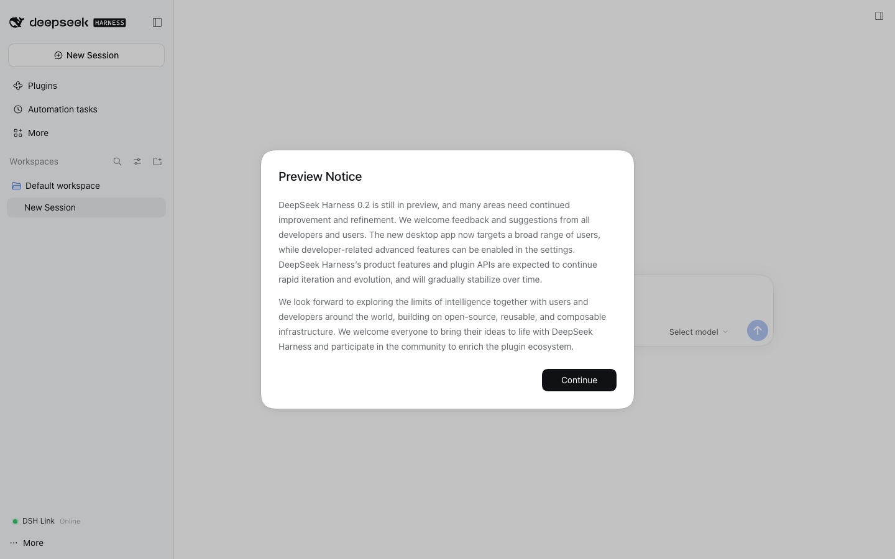

# DSH Link

**一条 TLS WebSocket，把你正在用的浏览器变成 DeepSeek Harness 桌面版的远程窗口。**

DSH Link 通过一条由桌面端主动外连的长连接，把**未经修改的** DeepSeek Harness
Web UI 提供到任意浏览器：桌面里的 agent 主动连到 edge，edge 把 HTTP 与
WebSocket 流转发给它，浏览器打开的就是真正的 DSH 界面。没有 WebRTC，没有 UDP，
不需要公网入站端口，不需要端口映射，也不用在面前的设备上再装一个客户端。


这张截图不是效果图：它是真实的 Harness 0.2.1 会话，由
[`tools/e2e/real-dsh.mjs`](../tools/e2e/real-dsh.mjs) 启动真实的 `dsh --profile web`、
edge、agent，完成 owner 初始化与配对后，用无头 Chromium 从
`http://<edge>/d/<device>/` 加载出来的。

> **状态：v0.1.0。** 协议、多路复用器、edge、agent、插件、测试与文档均已实现。
> 168 个自动化测试全绿，真实 DSH 端到端验证通过，下面的基准数字是实测值。
> 仍是预发布软件：请把插件当 beta，并在暴露桌面之前阅读
> [`THREAT-MODEL.md`](THREAT-MODEL.md)。

## 为什么再做一个远程插件

现有的 DSH 远程插件以 WebRTC 为第一优先级：ICE、STUN/TURN、每个平台一套客户端，
再加一台可能隔着半个地球的中转服务器。当网络封 UDP 或中转很远时，体验就是
"先卡住，然后掉线"。

DSH Link 反过来下注：

- **只有一种传输。** 443 端口上的出站 WSS。没有 UDP、没有 STUN/TURN、没有 ICE
  协商、没有原生 `wrtc` 依赖。酒店 Wi-Fi、企业 TLS 中间人、CGNAT、纯 IPv6
  网络都能用。
- **只有一个客户端。** 浏览器加载真实的 DSH 应用。聊天流式输出、工具、文件、
  终端，以及未来所有功能都随桌面版自动到位，不存在需要同步的 RPC 投影。
- **只有一处需要监督。** 心跳、退避、流控和优先级都在隧道里，而不是散落在
  三条回退路径中——其中第一条还要先等八秒才放弃。
- **真正的背压。** 每流 256 KiB、每隧道 8 MiB，信用只在字节被消费时归还。
  16 MiB 的下载不会给一次按键增加延迟：四条并发 16 MiB 传输下实测 p95 为 3.1 ms。

代价说清楚：edge 终止 TLS，因此能看到代理流量的明文。它是**受信任的中转**。
自托管是一等部署方式，[`THREAT-MODEL.md`](THREAT-MODEL.md) 明确写了这份信任的
边界。如果你需要"连中转服务器都无法解密"的端到端加密，这个设计不适合你——
[ADR-0001](adr/0001-no-webrtc.md) 解释了为什么仍然这样选。

## 架构

```
┌─────────────┐   HTTPS + WSS (443)   ┌──────────────┐   one multiplexed WSS   ┌───────────┐   loopback HTTP/WS   ┌─────────────┐
│   browser   │ ────────────────────▶ │     edge     │ ◀────────────────────── │   agent   │ ───────────────────▶ │ DSH desktop │
│ (anywhere)  │ ◀──────────────────── │  (self-host) │ ──────────────────────▶ │ (desktop) │ ◀─────────────────── │ web server  │
└─────────────┘                       └──────────────┘                         └───────────┘                      └─────────────┘
                                       auth · pairing                          mints the DSH                     unchanged
                                       presence · audit                        cookie, proxies
```

- **浏览器 → edge：** 普通的 443 端口 HTTPS/WSS。挂在 `/d/<deviceId>/` 子路径下，
  应用自身的相对 URL 与 `<base href="./">` 完成其余工作。
- **edge → agent：** 每台设备一条 WebSocket，多路复用成相互独立的 HTTP 与
  WebSocket 流，带每流流控和 high/normal/low 加权调度，批量传输抢不走交互流量。
- **agent → DSH：** 只连 `127.0.0.1:<port>`，使用由 DSH 启动 token 换来的 cookie。
  token 和 cookie 都不离开桌面。

细节见 [ARCHITECTURE.md](ARCHITECTURE.md)、[PROTOCOL.md](PROTOCOL.md)、
[ADR-0001](adr/0001-no-webrtc.md)。

## 环境要求

| 组件 | 要求 |
| --- | --- |
| 桌面端 | DeepSeek Harness **0.2.1-rc.3**；插件声明 `>=0.2.1-rc.3 <0.3.0` |
| Edge | Node.js ≥ 22.13（或 Docker 镜像），生产环境需要一个域名做 TLS |
| 浏览器 | 任意较新的 Chromium、Firefox 或 Safari |
| 网络 | 桌面端能出站访问 443；不需要入站端口，不需要 UDP |

## 快速开始

### 1. Edge

在一台小 VPS（或本机做演示）上：

```bash
git clone https://github.com/yeerock/dsh-link && cd dsh-link
npm ci && npm run build

node apps/edge/dist/main.js \
  --host 0.0.0.0 --port 8787 \
  --data-dir ~/.dsh-link --public-url https://link.example.com
```

启动时会打印一次性 **setup code**（在完成初始化前每次启动都会轮换）。
用仓库自带的 [Caddy + Docker 配置](../docker/docker-compose.yml) 在前面挡 TLS，
或者在负载均衡处终止 TLS 并以 `--trust-proxy` 运行。

### 2. Agent（也可以交给插件）

```bash
node apps/agent/dist/main.js \
  --edge https://link.example.com \
  --dsh-url-file ~/.dsh-link/upstream.json \
  --state-dir ~/.dsh-link/agent \
  --name my-desktop \
  --status-file ~/.dsh-link/agent/status.json
```

`upstream.json` 的内容是 `{ "url": "http://127.0.0.1:<port>/?token=…" }`，
权限 0600。token 故意**不接受**放在命令行参数里。首次运行会打印
`DSH_LINK_PAIR_URL=…`；以 owner 身份登录后打开它，即可批准设备并配对浏览器。
之后 DSH 界面就在 `https://link.example.com/d/<deviceId>/`。

### 3. 桌面插件（推荐）

插件从运行中的 DSH 桌面取得已认证 URL，写入 0600 文件，启动并监管 agent。
Harness 侧边栏显示状态点与标签；弹窗显示设备、edge、延迟、重连/重启次数、
运行时间、agent/pid、last error 和 Start/Restart/Stop 控制。**仅在状态为
pairing（或带新配对码的 error）时**，弹窗才显示 pair URL 的 Copy/Open 和配对
二维码，提示语是“扫描即可在浏览器中打开配对链接”；进入
online/connecting/reconnecting 后只显示 Paired + device id，因为配对码一次性，
需要重启 agent 才会产生新码。



```bash
dsh plugin --profile <profile> add link:"$PWD/packages/plugin"
```

在 profile 的用户层 `$DSH_HOME/profiles/<profile>/cordis.patch.yml` 中启用：

```yaml
- id: dsh-link
  config:
    enabled: true
    edgeUrl: https://link.example.com
    deviceName: my-desktop
    autoStart: true
```

然后以 `dsh --profile <profile> --port 0 --no-open` 启动；
`--profile <name>` 已替代 `dsh web` 简写，不要再追加 `web`。

安装、配置与排错见 [`packages/plugin/README.md`](../packages/plugin/README.md)；
部署形态、参数与 systemd 见 [DEPLOY.md](DEPLOY.md)。

## 安全摘要

- **DSH 启动 token 不离开桌面。** agent 用它一次性换成本地回环 cookie，只放在
  内存里；浏览器永远拿不到 DSH 凭证。
- **设备密钥是 32 字节随机数**，edge 只保存 SHA-256，隧道上用 Bearer token 发送。
- **配对码**是 8 字符、一次性、10 分钟有效，且必须由 owner 会话或 owner 密码
  配合才能兑换；它不是独立的 bearer 凭证。owner 会话 cookie 为 HttpOnly、
  Secure、SameSite=Lax，30 天。
- **edge 在终止 TLS 后能看到明文。** 这是设计，不是缺陷，见
  [`THREAT-MODEL.md`](THREAT-MODEL.md) 第 7.1 节。
- 即使 edge 被攻破，agent 也拒绝非回环上游、绝对 URL、`..` 以及编码后的路径穿越。
- 没有 WebRTC、没有 UDP、没有入站端口，也不做应用层 mutation 重放。

漏洞报告流程见 [SECURITY.md](SECURITY.md)。


## 验证

```bash
npm run typecheck        # 全 workspace 的 tsc -b
npm test                 # 168 个测试：单元 + 集成
npm run bench:quick      # 基准测试，JSON + markdown 写入 tools/bench/results
npm run e2e              # 启动真实 DSH web、edge、agent，再用 Chromium 验证
```

`npm run e2e` 就是上面截图的来源：独立 `DSH_HOME`、真实 `dsh --profile web`、
真实 edge、真实 agent，完成 owner 初始化、配对、取回 index、升级
`/api/remote.mux`，最后用 Chromium 渲染。它会断言代理出的 HTML 是 Harness
外壳、不含回环 origin，并且 UI 真的渲染出来。

实测环境：Apple M4 Pro（24 GiB，macOS 26，Node 24.18.0，2026-10-28），
**edge 在本机回环——这些数字衡量隧道开销，不含公网 RTT**：

| 指标 | 数值 |
| --- | ---: |
| 经 edge 的 TTFB，中位数 / p95 | 2.1 ms / 2.9 ms |
| 吞吐，1 MiB / 16 MiB | 157 / 299 MiB/s |
| 200 个串行请求 | 505 req/s（p95 2.1 ms） |
| 50 个并发请求 | 总计 16.6 ms（p95 约 19 ms） |
| 4 × 16 MiB 批量传输期间的交互 p95 | 3.1 ms |
| agent 重启后的隧道建立 | 2.7 ms |
| 被 4004 强制替换后的重连 | 49 ms |

真实 DSH 冒烟：index 37,907 B 字节一致，主 JS bundle 941,436 B 经隧道后
SHA-256 一致，`remote.mux` 升级成功。

## 明确不做的事

- **没有手机 App。** 浏览器就是客户端。
- **v1 没有 WebRTC 数据通道。** 取舍与重启条件见 [ADR-0001](adr/0001-no-webrtc.md)。
- **不在结果未知时重放 Harness mutation。**
- **不做第二套聊天/文件/终端 UI。** 这正是重点。
- **不是多租户 SaaS。** 先做好自托管；托管账号与 OAuth 在路线图上。

## 仓库结构

| 路径 | 内容 |
| --- | --- |
| [`packages/protocol`](../packages/protocol) | 线格式、帧校验、路径与请求头策略 |
| [`packages/mux`](../packages/mux) | 流、流控、优先级调度、心跳 |
| [`packages/shared`](../packages/shared) | WebSocket 适配、令牌、Cookie、日志 |
| [`apps/edge`](../apps/edge) | 公网 HTTPS/WSS 中转、认证、配对、SQLite、仪表盘 |
| [`apps/agent`](../apps/agent) | 桌面隧道客户端与回环代理 |
| [`packages/plugin`](../packages/plugin) | DeepSeek Harness 插件（宿主 + 侧边栏 UI） |
| [`tests`](../tests)、[`tools/bench`](../tools/bench) | 集成、故障注入、基准 |
| [`docs`](README.md) | 架构、协议、ADR、威胁模型、部署、运维手册 |

## 常见问题

**DSH token 会离开本机吗？** 不会。它在进程内被换成本地回环 cookie，浏览器看不到，
也不会写入磁盘或命令行参数。

**为什么不用 P2P？** 因为用户报告的正是 P2P 无法工作的网络；而且浏览器无法在没有
第二个客户端的情况下用 WebRTC 访问一个 HTTP origin。完整论证见
[ADR-0001](adr/0001-no-webrtc.md)。

**网络抖动时会怎样？** 15 秒心跳、45 秒空闲上限、250 ms 到 20 s 的 full-jitter
重连、30 秒 presence 宽限，且不重放消息。桌面崩溃也不会留下两个 agent 抢同一条
隧道：每个 stateDir 有单实例锁。

**可以自托管 edge 吗？** 这是主要部署方式。一个 Docker Compose 文件、Caddy 负责
TLS、一个 SQLite 文件负责备份。

更多：[FAQ.md](FAQ.md) · [OPERATIONS.md](OPERATIONS.md)。

## 许可证

MIT，见 [LICENSE](../LICENSE)。